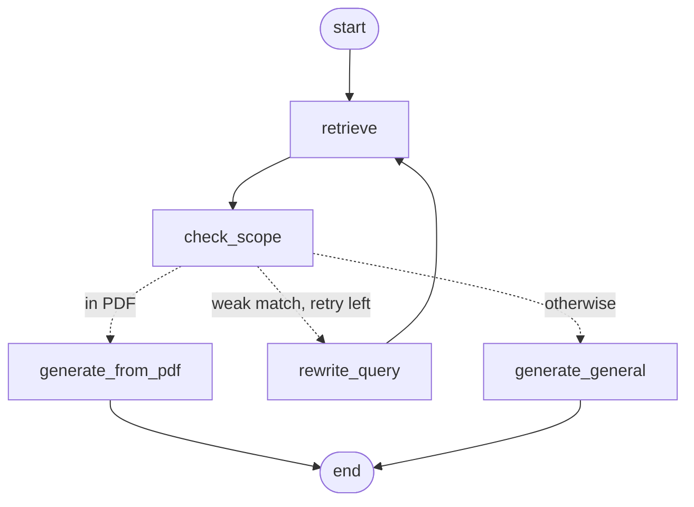

# PDF RAG — hybrid retrieval in the terminal

Ask questions about your PDFs from the command line. Answers come from the PDF with page citations.
When a question isn't covered by the PDF, the app still answers from the LLM's general knowledge,
but flags it clearly: **⚠ NOT FROM THE PDF**. The analytics panel shows the evidence behind every verdict.

## How it works

The question-answering flow is a [LangGraph](https://langchain-ai.github.io/langgraph/) state machine
(`src/graph/`). Print it any time with `python main.py graph`.



Inside `retrieve`:

```
question ─┬─ dense search (FastEmbed + ChromaDB) ─┐
          └─ keyword search (BM25) ───────────────┴─ RRF fusion ─ cross-encoder rerank
```

1. **Hybrid retrieval.** Vector search finds paraphrases, and BM25 finds exact terms (names, codes, rare words).
   Reciprocal Rank Fusion merges the two lists by rank, so their different score scales never need to be compared.
2. **Reranking.** A local cross-encoder reads the question and each candidate together and gives it a 0–1 relevance score.
3. **Scope check.** Uses the top rerank score (never the RRF score, which only reflects rank):
   - `>= 0.6`: in the PDF
   - `< 0.05`: out of the PDF
   - in between: one quick Groq call asks whether the excerpts actually answer the question
4. **Corrective retry.** If the question looks out of the PDF but something scored at least `0.005`,
   the LLM rewrites it into a search query and the graph loops back to `retrieve` (at most once).
   Near-zero scores skip this, because rewording can't find a topic the PDF doesn't cover.
   The scope check always judges against the *original* question, so a rewrite can't change what was asked.
5. **Answer.** In-PDF answers use only the excerpts and cite pages. Out-of-PDF answers use general knowledge and carry the banner.

Everything except the Groq call runs locally. The models download on first use (~250 MB) to `data/models/`.

## Setup

```bash
python -m venv rag_env
rag_env\Scripts\activate
pip install -r requirements.txt
copy .env.example .env      # then add your GROQ_API_KEY
```

## Usage

```bash
python main.py ingest                     # index every PDF in data/pdfs/
python main.py ingest path\to\file.pdf    # or a single file
python main.py ask "What was Xanadu?"     # one question, with analytics
python main.py ask "..." --no-scores      # answer only
python main.py chat                       # interactive loop: /scores /sources /quit
python main.py stats                      # index contents + in/out-of-PDF query summary
python main.py graph                      # print the LangGraph workflow (Mermaid)
python main.py reset                      # clear the index
```

Re-ingesting a file replaces its chunks instead of duplicating them.

## Images and scanned pages

At ingest time a vision model can read the parts of a PDF that text extraction misses:
figures and charts are described, and pages with no extractable text are rendered and transcribed.
The results are indexed as ordinary chunks (marked `from image`), so questions about a chart are answered
from the PDF and cited as `(figure, p. N)`.

Providers are tried in order:
1. **Gemini**, when `GEMINI_API_KEY` is set.
2. **Ollama**, when its server is running. It takes over when Gemini's quota is exhausted, and Gemini is tried again after 60 s.

```bash
python main.py vision-status              # is Gemini / Ollama ready?
python main.py ingest                     # images are described by default
python main.py ingest --no-images         # text only
```

Every description is cached by image hash in `data/vision_cache.json`, so re-running ingest costs nothing for
images already described. If some images fail (for example both providers are out of quota), ingest reports it;
run it again later and only the missing ones are processed. Icons under 150 px are skipped, and images the model
judges decorative (logos, dividers) are dropped. Set `OLLAMA_MODEL` in `.env` to any vision-capable model you have pulled.

Numbers read from charts are model-generated and can be slightly off, which is why answers flag figure sources.

## Analytics panel

Each answer shows the verdict, how it was decided (`high_score`, `low_score`, `llm_check`),
the graph path it took (e.g. `retrieve → check_scope → rewrite_query → retrieve → check_scope → generate_general`),
any rewritten search query, and a table of the retrieved chunks with their rerank, dense, BM25 and RRF scores and ranks.
A `-` in the Dense or BM25 column means that search missed the chunk, which shows what hybrid adds.
Every query is also logged to `logs/queries.jsonl`.

## Tuning

All settings are in `config.py`: models, chunk size and overlap, candidate counts, and thresholds.
To recalibrate the thresholds for your documents, ask a handful of questions you know are in the PDF
and a handful you know are not, then read `top_rerank_score` in `logs/queries.jsonl` and set
`high_confidence` / `low_confidence` to separate the two groups.

On the sample book, in-PDF questions scored 0.375–1.0 and unrelated questions scored ≤ 0.001.

The retry loop is controlled by `max_rewrites` (set it to `0` to turn the loop off) and `retry_min_score`.

## Groq rate limits

On Groq's free tier, `openai/gpt-oss-20b` allows about 8,000 tokens per minute. An in-PDF answer uses
roughly 2–3k tokens, so several quick questions in a row can hit the limit. When that happens the client
waits and retries automatically, and answers take 10–30 s instead of 1–2 s. To change models, set
`GROQ_MODEL` in `.env`.

## Web app: API + UI

```bash
uvicorn src.api.main:app --port 8000        # backend  (Swagger docs at http://localhost:8000/docs)
streamlit run app/streamlit_app.py          # UI       (http://localhost:8501)
```

| Endpoint | Purpose |
|---|---|
| `POST /ingest` | upload a PDF (`?images=true` to describe figures with Gemini) |
| `POST /chat` | `{question, persona, explain}` → answer, verdict, sources, timings, optional SHAP breakdown |
| `GET /documents`, `/health`, `/stats` | index contents, readiness, dashboard data |
| `GET /metrics` | Prometheus metrics (questions by verdict, answers by provider, fallbacks, latency histogram) |

The UI has three tabs: **Chat** (answer style picker, sources, "How was this decided?" with the SHAP chart),
**Monitoring** (verdicts, LLM providers, latency, recent questions, gate metrics) and **About**.

## Answer styles

`persona` is `default`, `formal`, `friendly`, `concise` or `eli5`. Each adds a style instruction plus one example of the voice
to the system prompt (`PERSONAS` in `src/generation/prompts.py`). The grounding and citation rules always come first and cannot be overridden.

## LLM fallback (Groq → Azure OpenAI)

`src/generation/llm_router.py` tries Groq first. If it raises for any reason (rate limit, timeout, outage), the same request goes to Azure OpenAI.
Set `AZURE_OPENAI_API_KEY`, `AZURE_OPENAI_ENDPOINT` and `AZURE_OPENAI_DEPLOYMENT` in `.env` to enable it; without them the backup is simply absent
and a Groq failure surfaces as a clear error. The answer reports which provider wrote it, and `/stats` and `/metrics` count fallbacks.

## Web search for out-of-PDF questions (Tavily)

When the gate decides the PDF does not cover a question, the app can search the web with [Tavily](https://tavily.com) and answer from the results,
citing them as [1], [2] with clickable links (the UI shows a blue "answered from web search" banner). Set `TAVILY_API_KEY` in `.env` to enable it.

- **Real-time questions always use the web**, even when the PDF touches the topic: news, prices, scores, weather, "latest/current/today", years 2025+.
  These search recent news (last 30 days, topped up with a normal search if few hits), the prompt gets today's date and each result's publication date,
  and the model must say how recent the information is. Questions about the PDF itself ("the book", "page 5") are never sent to the web.
- Only the question text is sent to Tavily, and only for out-of-PDF or real-time questions. PDF content never leaves the machine.
- Search results are treated as untrusted data: the prompt tells the model never to follow instructions found in them.
- If Tavily is down, rate-limited or finds nothing, the app falls back to the model's own knowledge (yellow banner) and says why.
- Without a key nothing changes: out-of-PDF answers come from model knowledge, flagged "NOT FROM THE PDF".

## Answerability gate and explainability

The in-PDF / out-of-PDF decision used to be two hand-picked thresholds on the reranker score. It is now a trained classifier
(`src/gate/`) over nine retrieval signals (top score, score gap, embedding similarity, keyword hit, question/passage word overlap, ...).

```bash
python -m ml.build_gate_dataset       # in-PDF questions written by the LLM from random passages + 113 verified not-in-PDF questions
python -m ml.train_gate               # clean, split, 5-fold CV of two models, evaluate, compare with the old rule, save to models/gate/v1/
python -m ml.bias_check               # error rates by question length and opening word
```

Outputs in `models/gate/v1/`: `gate.joblib`, `metrics.json` (CV, test, baseline), `shap_summary.png`, `bias_report.json`.
Without a trained gate the app falls back to the old thresholds, so nothing breaks.
Every decision can be explained with **SHAP** (`"explain": true` on `/chat`): exact Shapley values show how much each signal pushed
the probability toward or away from "in the PDF", and they sum to the final probability.

## Docker

```bash
cp .env.example .env        # add your keys
docker compose up --build   # API on :8000, UI on :8501; data/ and logs/ are mounted as volumes
```

## Tests

```bash
pytest
```

## Project layout

```
main.py                     CLI (Typer)
config.py                   all settings
src/ingestion/              PDF text extraction and chunking
src/indexing/               embeddings, ChromaDB, BM25
src/retrieval/              RRF fusion, reranker, retriever
src/generation/             Groq client and prompts
src/graph/                  LangGraph state, nodes and graph wiring
src/search/                 Tavily web search client
src/vision/                 Gemini / Ollama providers, fallback and cache for image descriptions
src/pipeline/               scope checker, ingestion and graph runner
src/analytics/              terminal display and query log
src/gate/                   answerability classifier: features, loading, SHAP explanations
src/api/                    FastAPI app and request/response schemas
src/monitoring/             Prometheus metrics
app/streamlit_app.py        web UI
ml/                         gate dataset builder, training, bias check
models/gate/               versioned trained gate + metrics + plots
tests/                      chunker, RRF, scope-checker, graph-routing, router-fallback, gate/SHAP and API tests (no keys or network needed)
```
